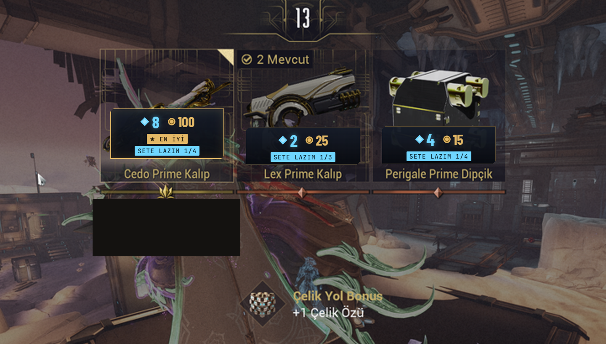
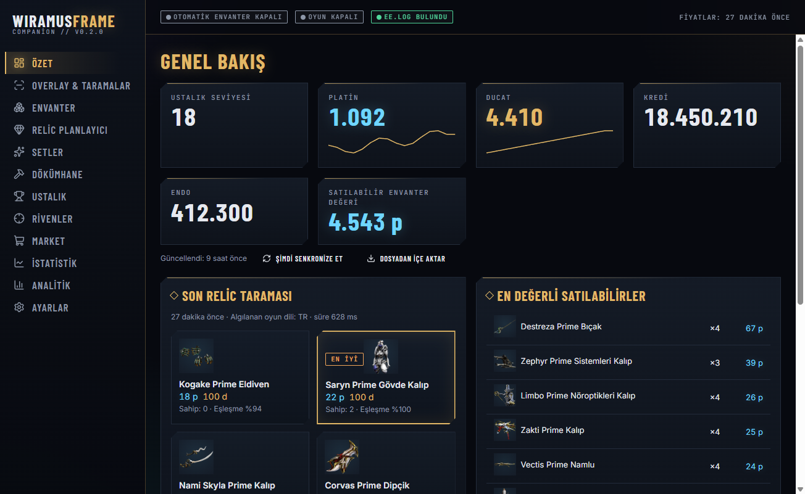
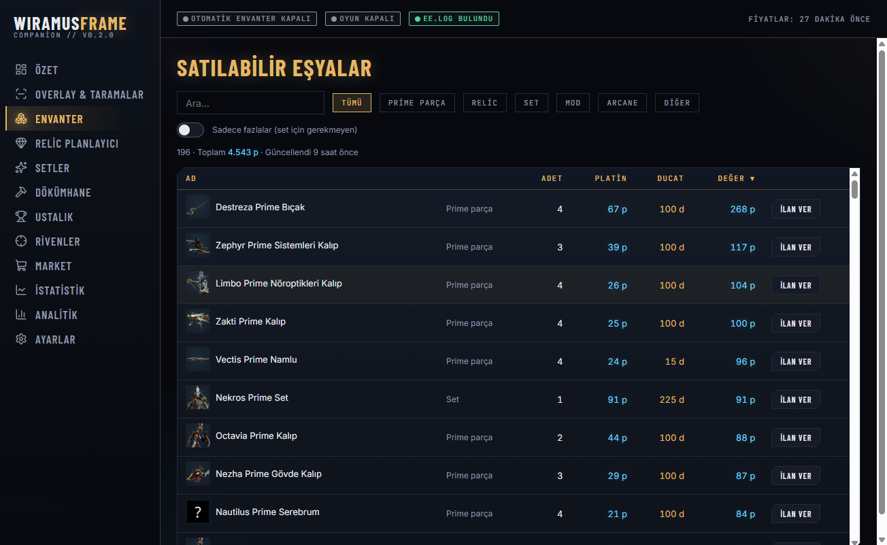
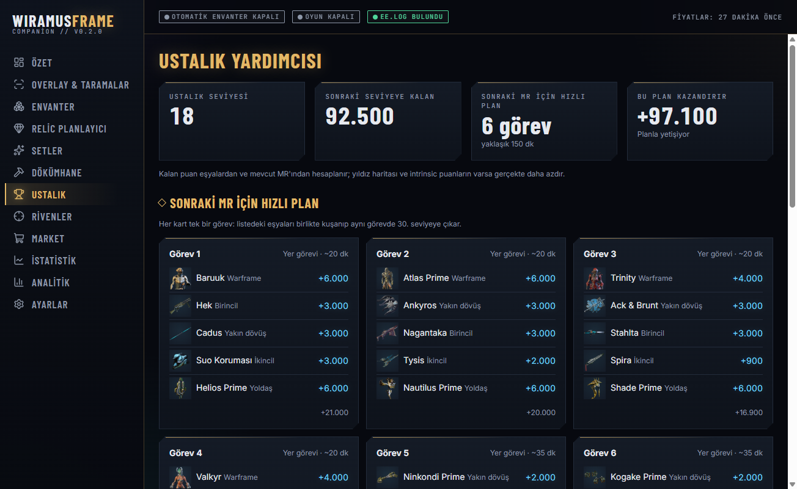
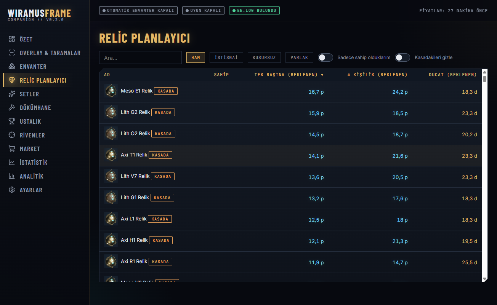
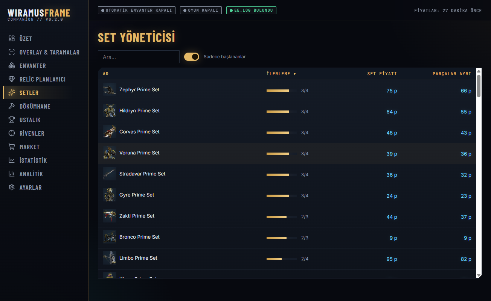
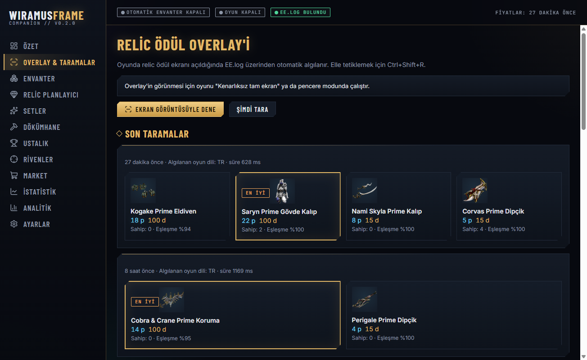

# WiramusFrame

**Warframe için açık kaynak, Overwolf'suz yardımcı uygulama.** Relic açtığında her ödülün
platin ve ducat değerini, setinden kaç parçan olduğunu ve "alırsam ne olur"u **oyunun
üstünde** gösterir. Oyun **Türkçe olsa bile** çalışır.

*An open-source, Overwolf-free Warframe companion. Shows relic reward values on top of the game,
works with Turkish and English game clients. [English below](#english).*

[](https://github.com/Wiramuss/wiramusframe/actions/workflows/release.yml)
[](LICENSE)
[](https://github.com/sponsors/Wiramuss)

> Bağımsız bir hayran projesidir. Digital Extremes, Warframe veya warframe.market ile ilişkili değildir.
> Warframe ve ilgili adlar Digital Extremes Ltd.'nin markalarıdır.
>
> **Uygulamayı kullanarak [Kullanım Şartları](TERMS.md)'nı kabul etmiş olursun.** Hesap askıya alınması (ban)
> dahil hiçbir sonuçtan geliştiriciler sorumlu değildir.

<p align="center"></p>
<p align="center"><em>Türkçe oyunda relic ödül ekranı: her parçanın üstünde platin, ducat, ★ en iyi seçim ve set durumu.</em></p>

## Ekran görüntüleri

| Genel bakış | Envanter |
| --- | --- |
|  |  |
| **Hızlı ustalık planı** | **Relic planlayıcı** |
|  |  |
| **Setler** | **Tarama geçmişi** |
|  |  |

## Neden WiramusFrame?

| | WiramusFrame |
| --- | --- |
| Overwolf gerekmez | Kendi başına çalışan Windows uygulaması. Reklam yok, analitik/telemetri yok. |
| Oyuna dokunmaz | Ödül ekranını **ekran görüntüsü + OCR** ile, açılışı **EE.log** dosyasından anlar. Oyuna kod enjekte etmez, oyun dosyalarını değiştirmez. |
| Türkçe | Arayüz Türkçe/İngilizce. Relic ödül okuma oyun Türkçe veya İngilizce iken çalışır. |
| Açık kaynak | Her satır burada. Her sürüm Windows Defender ve ClamAV ile taranır, SHA-256 değerleri yayınlanır. |
| Ücretsiz | Tüm özellikler ücretsiz. Beğenirsen [bağışla destek olabilirsin](https://github.com/sponsors/Wiramuss). |

## Özellikler

- **Relic ödül overlay'i:** her parçanın üstünde platin, ducat, ★ en iyi seçim, "SETİ TAMAMLAR / SETE LAZIM 2/4 / FAZLA", kasada (vaulted) bilgisi.
- **Envanter:** prime parçalar, setler, eksik parçalar, toplam değer.
- **Bellek okumadan envanter:**
  - **Ekrandan tarama:** oyunda Envanter/Dökümhane sayfası açıkken **Ctrl+Shift+I** — görünen eşyalar ve adetleri okunur.
  - **Ödül ekranı:** oyunun gösterdiği "N Mevcut" adetleri envantere yazılır.
  - **EE.log:** açtığın relic envanterinden otomatik düşülür.
- **Relic planlayıcı:** ortalama platin/ducat değerine göre hangi relicleri açmalı.
- **Hızlı ustalık planı:** sonraki MR için eşyaları görev görev gruplar.
- **Dökümhane, rivenler, warframe.market ilanları, istatistikler.**

## Kurulum

1. [Releases](https://github.com/Wiramuss/wiramusframe/releases) sayfasından `WiramusFrame-Setup-x.y.z.exe` dosyasını indir.
2. İstersen doğrula: `certutil -hashfile WiramusFrame-Setup-x.y.z.exe SHA256` çıktısı `SHA256SUMS.txt` ile aynı olmalı.
3. Kur ve aç. Kurulum dosyası henüz imzasız olduğu için Windows SmartScreen "Bilinmeyen yayıncı" diyebilir: **Ek bilgi → Yine de çalıştır**.
4. İlk açılışta Kullanım Şartları'nı oku ve kabul et.
5. Warframe'i **Kenarlıksız tam ekran** veya pencere modunda çalıştır (overlay'in görünmesi için).
6. Relic açtığında kartlar kendiliğinden çıkar. Elle taramak için **Ctrl+Shift+R**.

## Güvenlik ve hesap riski

Digital Extremes'in tutumu: harici yazılımları **kullanım riski kullanıcıya aittir**.
WiramusFrame varsayılan olarak yalnızca ekran görüntüsü ve oyunun kendi yazdığı EE.log dosyasını okur.

**Otomatik envanter (deneysel, varsayılan KAPALI):** Ayarlar'dan açılırsa envanteri oyunun
belleğinden okur. Bu yöntem Warframe kullanım koşullarına aykırı sayılabilir ve **hesabının
askıya alınmasına (ban) yol açabilir**. Açmadan önce uygulama ayrı bir sorumluluk reddi onayı ister.
Bu özelliği açmanın tüm sonuçları kullanıcıya aittir; ayrıntılar [TERMS.md](TERMS.md).
Riskten kaçınmak için kapalı bırak; envanterini **ekrandan tarayarak** (Ctrl+Shift+I) veya JSON içe aktararak doldurabilirsin.

## Destek ol

Proje tamamen ücretsiz ve gönüllü. Geliştirmeye katkı için:
- 💖 [GitHub Sponsors](https://github.com/sponsors/Wiramuss) ile bağış
- 🐛 [Hata bildir veya özellik iste](https://github.com/Wiramuss/wiramusframe/issues)
- 🛠️ Kod katkısı: [CONTRIBUTING.md](CONTRIBUTING.md)
- 🌍 Yeni oyun dili ekle (en çok istenen katkı: Almanca, Fransızca, İspanyolca, Rusça, Portekizce, Lehçe…)

Bağışlar gönüllüdür; bağış yapmak ek özellik, destek garantisi veya herhangi bir hak doğurmaz.

## Geliştirme

```bash
npm install
python scripts/build_data.py          # resources/gamedata.json (DE PublicExport + warframe.market)
python scripts/gen_fixtures.py 60 99  # sentetik ödül ekranları (OCR testleri için)
npm test                              # birim + OCR testleri
npm start                             # derle + çalıştır
npm run dist                          # release/ içine kurulum dosyası
```

Yapı: `src/core/` (OCR, oyun verisi, envanter, EE.log, ağ, bellek okuyucu), `src/main/` (Electron, overlay penceresi),
`src/renderer/` (React arayüzü, overlay, metinler).

## Yol haritası

- [ ] Relic ödül okuma için daha fazla oyun dili
- [ ] Linux desteği (Proton/Wine EE.log yolu, AppImage)
- [ ] Uygulama içinden günlük oyun verisi güncellemesi
- [ ] İmzalı kurulum dosyası

---

## English

**WiramusFrame** is a free, open-source (GPL-3.0) Warframe companion for Windows that does **not** need Overwolf.

- Relic reward overlay: platinum, ducats, best pick, set status, vaulted, drawn right on top of each reward.
- Works when the game client is in **Turkish** or English; UI in Turkish and English.
- Reads only screenshots and the game's own `EE.log` by default. No injection, no game file changes, no ads, no telemetry.
- Inventory, sets, relic planner, fast mastery plan, foundry, rivens, warframe.market listings.
- Every release is built by GitHub Actions, scanned with Windows Defender and ClamAV, and published with SHA-256 sums.
- Optional automatic inventory reads game memory. It is **off by default** and may get your account suspended.

**By using the software you accept the [Terms of Use](TERMS.md). You use it entirely at your own risk; the authors
accept no liability for any account suspension, ban, data loss or other damage.**

Not affiliated with Digital Extremes or warframe.market. Support development via [GitHub Sponsors](https://github.com/sponsors/Wiramuss).
